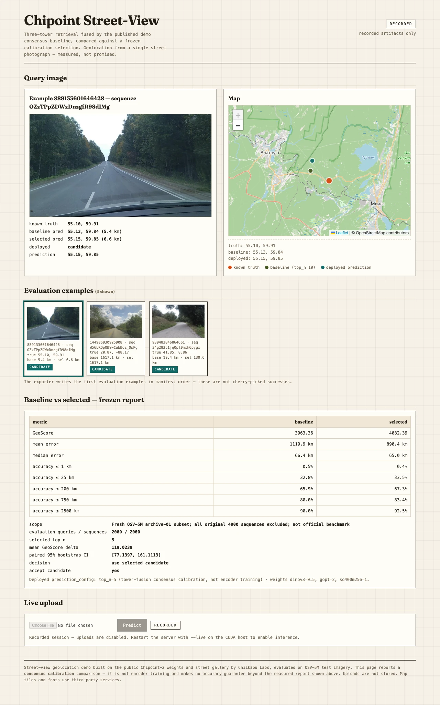

# Chipoint Calibration Lab

A reproducible street-photo geolocation experiment and presentation demo,
built on [Chiikabu Labs' Chipoint v2](https://huggingface.co/chiikabu-labs/chipoint-2).

**Status:** a verified calibration gain is saved in
[the accepted v2 checkpoint](checkpoints/fusion-v2/README.md).
On 2,000 fresh, sequence-disjoint evaluation images, GeoScore increases
3963.36 -> 4082.39 (paired 95% difference interval +77.14 to +161.11),
and Acc@25km increases 32.80% -> 33.50%. These are development-subset results
against the public street-view demo baseline, not the published full pipeline.
The earlier depth-only attempt failed and remains preserved separately.
A further refinement on 4,000 new sequences also failed its acceptance gate;
the saved v2 checkpoint remains deployed. Synthetic tests are software checks,
not model results.



## What We Built

- Integrated the public demo's three frozen street-view towers with their
  matching projection heads and reference galleries.
- Added pinned asset retrieval, integrity checks, sequence-disjoint sampling,
  immutable retrieval caches, and a bounded calibration comparison.
- Added a one-command worker, interruption recovery, result export/sync,
  and a presentation UI with explicitly labeled recorded/live modes.
- Kept the baseline whenever the selected candidate fails the acceptance gate.

We did **not** train Chipoint's encoders or reproduce its unpublished full
reranker. The experiments change relative tower-fusion weights and
geographic-consensus depth, not encoder weights. The published full-pipeline
model-card score is not our baseline.

## Pipeline

```text
street image
  -> SO400M SigLIP2 / GOPT SigLIP2 / DINOv3
  -> each tower's own 512-D projection and matching street gallery
  -> cached top-200 candidates per tower
  -> equal-weight or calibrated z-score fusion, retaining 64 candidates
  -> baseline geographic consensus or tuning-selected consensus depth
  -> latitude / longitude
```

Different towers' embedding spaces are never mixed directly.

## Experiment

All attempts use the original 2,000 tuning sequences. Each final comparison
uses a different evaluation cohort, one image per sequence, excluding every
previously used sequence. Candidates are locked before each fresh comparison.

| Attempt | Fresh Evaluation | Reference | GeoScore Difference | Decision |
|---|---:|---|---:|---|
| Depth-only | 2,000 | Original public-demo baseline | +4.55 | Reject |
| Fusion v2 | 2,000 | Original public-demo baseline | +119.02 | Accept |
| Refinement v3 | 4,000 | Saved v2 checkpoint | +6.24 | Reject |

The gains above come from different cohorts: do not add them or compare raw
scores across those cohorts. The final deployed parameters remain
SO400M:GOPT:DINOv3 = **1:2:0.5**, consensus depth **5**.

The first protocol is in `experiment_config.json`. See
[FUSION_EXPERIMENT.md](FUSION_EXPERIMENT.md) and
[REFINEMENT_EXPERIMENT.md](REFINEMENT_EXPERIMENT.md) for the later preregistered
searches, unchanged assets, and progressively fresh evaluation cohorts.
V3's 95% interval is [-4.59, +17.19]; its stricter three-attempt adjusted
interval also crosses zero. It does not replace v2.

Frozen reports, selections and verification receipts are in `results/`.
The accepted checkpoint is tagged **checkpoint-fusion-v2**. Every deployment
gate requires positive GeoScore evidence and no observed Acc@25km decline;
v3 additionally uses a 98.3333% Bonferroni interval across the three attempts.

This is a development-subset comparison, not an untouched official benchmark.
See [EVALUATION.md](EVALUATION.md) for metrics, separation, and limitations.

## Local Demo

With Python 3.11+ and [uv](https://docs.astral.sh/uv/):

```bash
uv venv --python 3.11 .venv
uv pip install --python .venv/bin/python -r requirements-demo.txt
.venv/bin/python scripts/serve_demo.py --run-dir results/attempt-2
```

Open http://127.0.0.1:8000. This displays the committed, real v2 report without
requiring the model weights. The three photo examples remain in the locally
synced run, not Git; use `--run-dir artifacts/experiment-v2` on the presentation
machine for the complete recorded demo. Recorded mode never fabricates
examples or scores. [PITCH.md](PITCH.md) contains the five-minute script;
[SUBMISSION.md](SUBMISSION.md) contains the Devpost draft and checklist.
Map tiles/fonts use third-party services; coordinates remain available as
a fallback. `--live` enables real uploads only on a prepared CUDA host.

## GPU Run

Read [GPU_PREP.md](GPU_PREP.md) and [LAUNCH_PLAN.md](LAUNCH_PLAN.md) first.
These scripts do not rent or terminate instances and cannot cap cloud billing.

```bash
bash scripts/run_once.sh              # safe dry-run, no downloads/installs
bash scripts/run_once.sh --execute    # explicitly run on the prepared GPU host
```

The actual run downloads only the selected model/gallery assets plus OSV-5M
test.csv and archive 00.zip, not the full training corpus. It writes:

```text
artifacts/experiment-v1/
  manifest.json             fixed image/sequence/split membership
  cache/                    per-tower, per-batch retrieval results
  selected.json             tuning winner, locked before final evaluation
  report.json               paired final metrics and acceptance decision
  prediction_config.json    deployed baseline or accepted calibration
  predictions.csv           paired final-query predictions/errors
  demo_examples/            first three evaluation images, not best cases
```

Model blobs, credentials, datasets, and generated artifacts are excluded from
Git. Follow [SUBMISSION.md](SUBMISSION.md) for the five-minute pitch and Devpost
checklist. The repository remains private; judges need an explicitly approved
accessible code/project link before submission.

## Attribution And Scope

- Chipoint v2 and the reference street-view demo: **Chiikabu Labs**.
- Frozen vision backbones: SigLIP2 via OpenCLIP and Meta DINOv3.
- Evaluation imagery: **OSV-5M**. Image IDs and original split are retained.
- Pinned demo source and provenance: `upstream/DEMO_SOURCE.txt`.
- DINOv3's licence is preserved in its encoder directory; it is not an
  MIT-licensed model. Respect all upstream model, data, and software terms.

This is street-view geolocation, not a guarantee about arbitrary photographs.
A model guess is not proof of a person's location.
